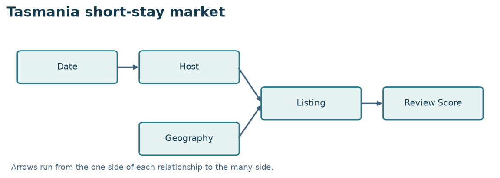

# Data model

| One side | Many side | Filter direction |
| --- | --- | --- |
| Host · Host ID | Listing · Host ID | One to many |
| Geography · Neighbourhood | Listing · Neighbourhood | One to many |
| Date · Date | Host · Host Since | One to many |
| Listing · Listing ID | Review Score · Listing ID | One to many |

Price Scenario, Rating Threshold and Funnel Stage are disconnected helper tables. Their selections are read by measures.
